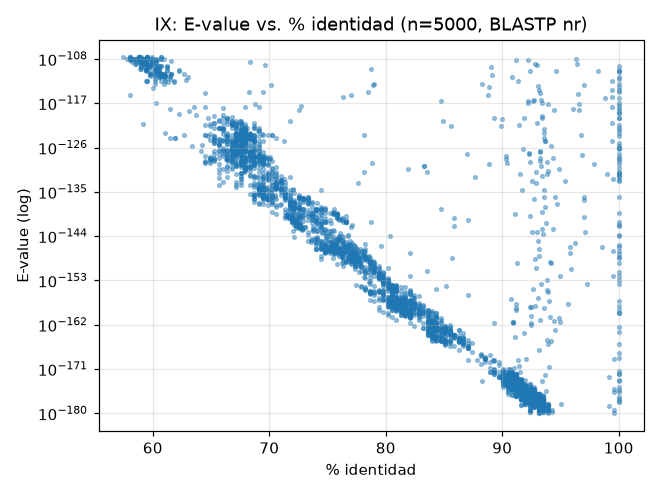
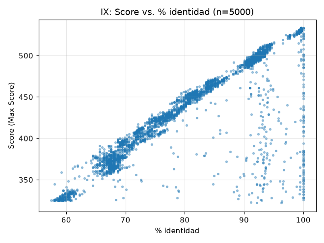
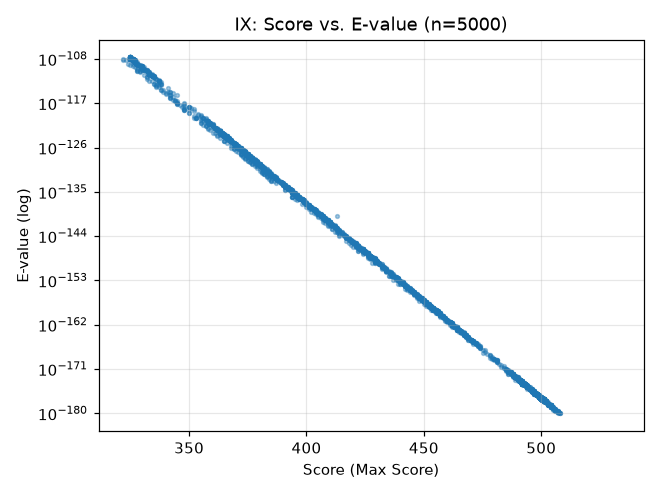

# Desafío IX — Identificación de la proteína problema (262 aa)

La fuente es `CXJR2NNZ014-Alignment desafio iX .txt`, un resultado de BLASTP contra nr (query de 262 aminoácidos, RID CXJR2NNZ014). Reconstruí el query a partir de los HSP y coincide con la secuencia completa del enunciado (262/262 residuos). El primer alineamiento detallado tiene identidad completa y Expect 0.0. La tabla de 5000 hits, sin filtrar, está en `resultados/blast_ix.tsv`.

## Identificación probable: LpxA

Los resultados apuntan a la acil-ACP–UDP-N-acetilglucosamina O-aciltransferasa (LpxA), codificada por `lpxA` y asociada a la primera etapa de la vía de Raetz para sintetizar lípido A, parte del lipopolisacárido de bacterias gramnegativas.

La anotación aparece en 4714 de los 5000 hits (94%; 4085 registros con ese nombre y 629 MULTISPECIES). El hit superior es `WP_000565966.1`, con 100% de identidad y cobertura, score 533 y E-value 0.0. Entre los resultados también hay estructuras de LpxA de *E. coli*, como `2JF2_A` y `7OKC_A`.

El organismo más probable para el query es *Escherichia coli*: hay 693 hits asociados al taxid 562. También aparecen enterobacterias cercanas, entre ellas *Klebsiella* (573), *Salmonella* (28901) y *Vibrio* (666). Esto permite asignar el query a LpxA con bastante confianza; la tabla por sí sola no determina la cepa exacta.

El hit con menor score entre los 5000 tiene E-value 2e-108 e identidad de 57%. En el conjunto recuperado, incluso los hits más divergentes tienen valores estadísticamente muy significativos. Esto respalda que son homólogos de LpxA, aunque la función de cada secuencia no se confirma solo con el E-value.

## Relación entre E-value, identidad y score

En los 5000 hits, los E-values van de 0.0 a 2e-108; 805 aparecen como 0.0 y todos son ≤ 1e-10. La identidad va de 57% a 100% (2467 hits tienen al menos 90% de identidad), los scores de 322 a 533 y la cobertura de 61% a 100%. 4492 alineamientos cubren el 100% del query.

Las correlaciones de Spearman son: identidad y log10(E-value), −0,872; identidad y score, +0,871; score y log10(E-value), −0,998. El patrón coincide con lo visto en los desafíos VII y VIII: los hits de mayor identidad tienden a tener scores más altos y E-values menores.

La correlación de Pearson entre score y log10(E-value) es −0,803, menos cercana a −1 que la de Spearman. En 805 filas el E-value figura como 0.0; para graficar logaritmos esos valores se reemplazaron por un piso numérico. Ese empate artificial afecta la correlación de Pearson, mientras que Spearman conserva mejor el orden de los valores.

A diferencia del desafío VII, en estos 5000 hits no se observa una cola de E-values altos: el más alto informado es 2e-108. En el gráfico de E-value aparece un grupo de 805 puntos en 0.0, que refleja el límite de precisión del formato del reporte. Por debajo de ese piso se observan E-values muy pequeños, incluso para secuencias más divergentes; por ejemplo, un hit de *Aeromonas* tiene 58,8% de identidad, score 325 y cobertura completa.
