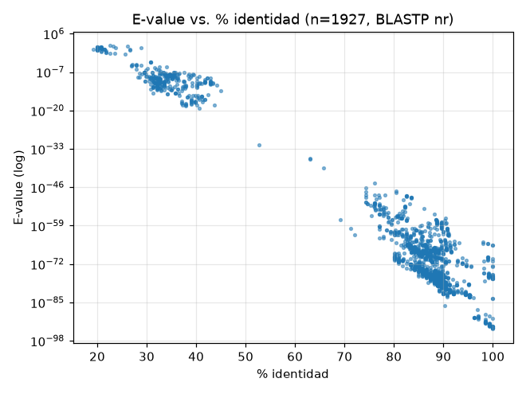
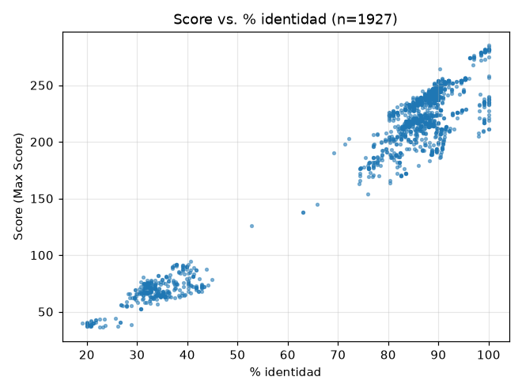
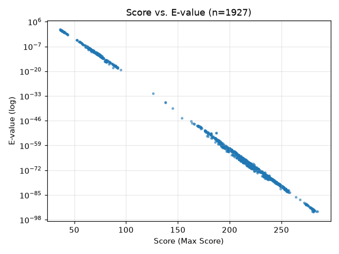

# Desafío VII — Comportamiento E-value vs. %id, Score vs. %id, Score vs. E-value

Fuente: `resultados/blast_vii.tsv` (1927 hits, BLASTP vs nr, query 133 aa, RID web CV1UE1Z8014 + CSV API del mismo RID).
Filtro pedido (E<=100, cobertura>=70%): 1927/1927 (E máx=84, cobertura mín=70%). El filtrado no recorta nada.
Rangos: E-value 1e-94–84; %id 19,13–100; Max Score 36,2–285. Ver `resultados/NOTAS_fuente.txt` (límites: no acredita EXPECT=100 ni 20000 hits).

Correlaciones (n=1927):
- %id vs. log10(E): Spearman −0,821 / Pearson −0,972.
- %id vs. Score: Spearman +0,808 / Pearson +0,970.
- Score vs. log10(E): Spearman −0,999 / Pearson −1,000.

## 1. E-value vs. %id — decreciente, no lineal

A mayor %id, E-value varios órdenes menor (eje log). Extremos: 100% id → E~1e-94 (prión humano/gorila); ~90% → E~1e-80; ~40% → E~1e-18; ~20–25% → E~1–84 (doppel, Staphylococcus, Golgi/endoribonucleasas: ruido de E alto por EXPECT permisivo).
La dispersión a %id fijo (p. ej. 88–90% con E entre 1e-80 y 1e-70) muestra que el E-value no depende solo del %id sino del largo alineado, gaps y tamaño de la base (nr). Por eso la relación es monótona pero no una función.

## 2. Score vs. %id — creciente con saturación

El Score crece con %id (Pearson +0,970), pero se aplana arriba: los topes (~280–285) corresponden a 99–100% id y cobertura 100%; a igual %id alto el score varía poco. Abajo (%id<40) el score cae a 36–90 con más dispersión por alineamientos cortos/parciales y composiciones distintas (tortugas, aves PRIO, Xenopus). El score pondera sustituciones (matriz) y gaps, así que dos hits con igual %id pueden diferir en score.

## 3. Score vs. E-value — casi determinista en log

Correlación ≈ −1 en log10(E). Es lo esperado por Karlin-Altschul (E ≈ K·m·n·e^(−λS)): a más score, E-value exponencialmente menor. La nube es una recta en escala log con mínima dispersión (la que hay viene de ajustes composicionales y longitudes efectivas). E-value y score ordenan casi igual; el E-value agrega el contexto del tamaño del espacio de búsqueda.

## Lectura biológica mínima

El query es prión (PrP): identidad 100% con humano, ~99–96% primates, ~90% mamíferos, cayendo hacia marsupiales/monotremas (~75–80%), reptiles/aves (~30–40%) y ruido bacteriano/fúngico con E alto. Cobertura casi siempre ≥90% (mín 70%), o sea alineamiento global del dominio C-terminal, no fragmentos espurios.

## Advertencia

Con E<=100 entra todo (incluso E=61–84, p. ej. proteínas de tráfico Golgi/ER y endonucleasas), así que el corte pedido no separa homólogos de ruido: para inferencia usar E<<1e-10 y mirar %id+cobertura+taxonomía, no solo el E-value.
