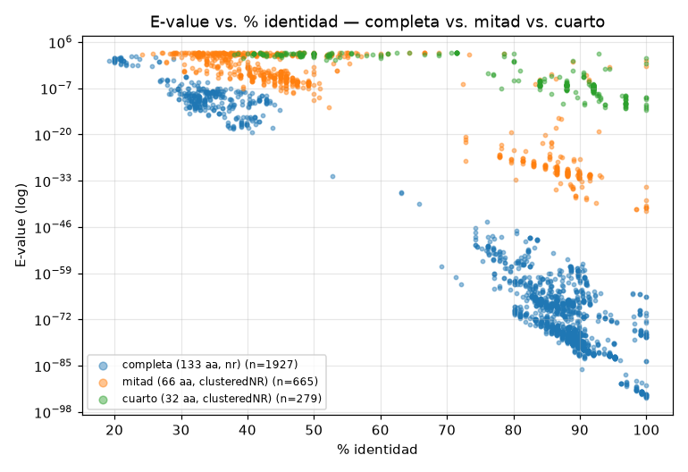
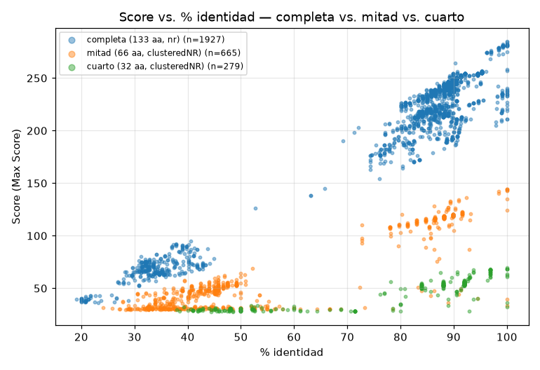
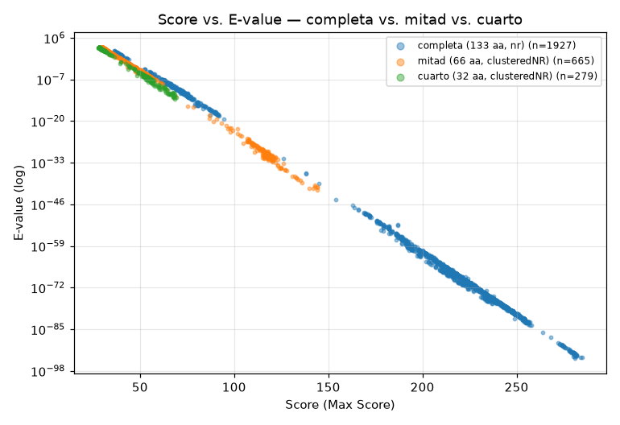
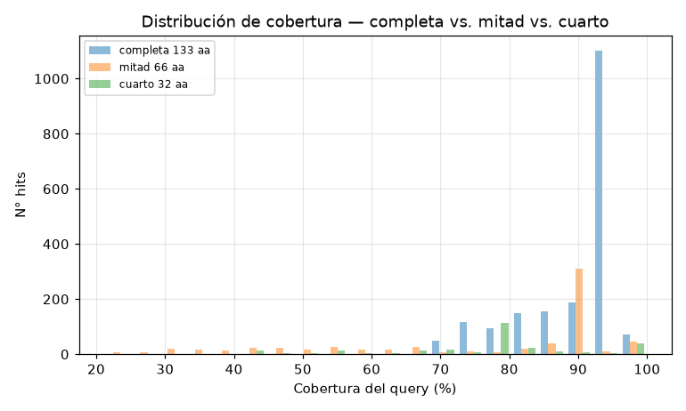

# Desafío VIII — Comparación entre la secuencia completa y dos fragmentos

Revisé los alineamientos para confirmar qué fragmentos se usaron. La mitad corresponde a los 66 aminoácidos iniciales (`VVGGL...NITIKQ`) y el cuarto a los 32 aminoácidos iniciales (`VVGGL...RYYRE`); ambos son prefijos de la secuencia problema de 133 aminoácidos.

| Query | RID web | Longitud | Base | Hits en la tabla |
|---|---|---:|---|---:|
| Completa | CV1UE1Z8014 | 133 aa | nr | 1927 (`resultados/blast_vii.tsv`) |
| Mitad | CXHB5NFK016 | 66 aa | ClusteredNR | 665 (`resultados/blast_viii_mitad.tsv`) |
| Cuarto | CXHPJ65D014 | 32 aa | ClusteredNR | 279 (`resultados/blast_viii_cuarto.tsv`) |

La búsqueda completa se hizo contra nr y las de los fragmentos contra ClusteredNR, que agrupa secuencias redundantes. Por eso, la cantidad de hits no se puede comparar directamente entre las tres búsquedas. Las diferencias de E-value y score sirven para describir estos resultados, aunque también dependen de la base consultada.

## Resumen de resultados

Los rangos se muestran como mínimo–máximo y, entre paréntesis, la mediana.

| Query | E-value | Identidad (%) | Max Score | Cobertura (%) | E ≤ 1e-10 | E > 10 |
|---|---|---|---|---|---:|---:|
| Completa | 1e-94–84 (1e-71) | 19–100 (88,1) | 36–285 (224) | 70–100 (95) | 91,1% | 0,9% |
| Mitad | 4e-42–997 (7e-4) | 24–100 (45,3) | 29–144 (47) | 21–100 (89) | 25,6% | 34,1% |
| Cuarto | 8e-14–986 (3e-6) | 38–100 (88,0) | 28–69 (51) | 38–100 (78) | 9,7% | 37,6% |

## E-value e identidad

En las tres búsquedas, los hits de mayor identidad tienden a tener E-values menores. Al usar fragmentos, los mejores E-values observados son menos pequeños: 1e-94 para la secuencia completa, 4e-42 para la mitad y 8e-14 para el cuarto. Esto coincide con que un alineamiento corto acumula menos evidencia que uno largo, aunque las diferencias entre bases de datos también afectan la comparación.

En las búsquedas de los fragmentos aumenta la proporción de hits con E-value mayor que 10: pasa de 0,9% en la búsqueda completa a 34,1% y 37,6%. Esa parte de los resultados requiere cautela; con valores así de altos, no se puede interpretar cada hit como homólogo solo por aparecer en la tabla.

## Score e identidad

El score máximo baja de 285 a 144 y 69 al pasar de la secuencia completa a la mitad y al cuarto. Dividir esos máximos por la longitud da valores parecidos, alrededor de 2,15 bits por aminoácido. Es una comparación descriptiva de estas tres corridas; no implica que todos los alineamientos escalen de manera uniforme.

En las tres búsquedas, los mejores hits siguen correspondiendo a proteínas priónicas. Sin embargo, con el fragmento de 32 aminoácidos el rango de scores es más acotado y hay menos información de secuencia para distinguir hits cercanos. La identidad por sí sola tampoco alcanza para clasificar los hits más débiles.

## Score y E-value

La asociación entre score y log10(E-value) sigue siendo muy marcada en las tres tablas (Spearman entre −0,994 y −0,999). Dentro de cada búsqueda, los scores mayores suelen acompañarse de E-values menores. Los valores absolutos entre búsquedas no son directamente equivalentes: cambia la longitud del query y, en este caso, también la base de datos.

## Conclusiones

1. En estos resultados, el mejor E-value aumenta al acortar el query: de 1e-94 con la secuencia completa a 4e-42 con la mitad y 8e-14 con el cuarto. También baja la proporción de hits con E ≤ 1e-10: 91,1%, 25,6% y 9,7%, respectivamente.
2. Los scores máximos son aproximadamente proporcionales a la longitud en estas tres corridas, pero los fragmentos ofrecen menos información para separar resultados débiles.
3. Las relaciones generales entre identidad, score y E-value se mantienen. Las diferencias observadas también pueden depender del uso de nr para la secuencia completa y ClusteredNR para los fragmentos.
4. La cobertura mínima y mediana son menores en las corridas con fragmentos (mínimos de 70%, 21% y 38%; medianas de 95%, 89% y 78%). Esto indica que en esas tablas aparecen más alineamientos que cubren solo una parte del query.
5. Los mejores hits siguen siendo priones, pero eso no vuelve confiable al resto de la tabla: al acortar la secuencia, aumenta la proporción de E-values altos y se necesita evaluar cada hit con más cuidado.
6. En estas búsquedas, los fragmentos recuperan los hits más cercanos, pero la evidencia es más limitada para caracterizar relaciones lejanas. La longitud, el E-value, la cobertura, la identidad y la base de datos deben considerarse juntos.
