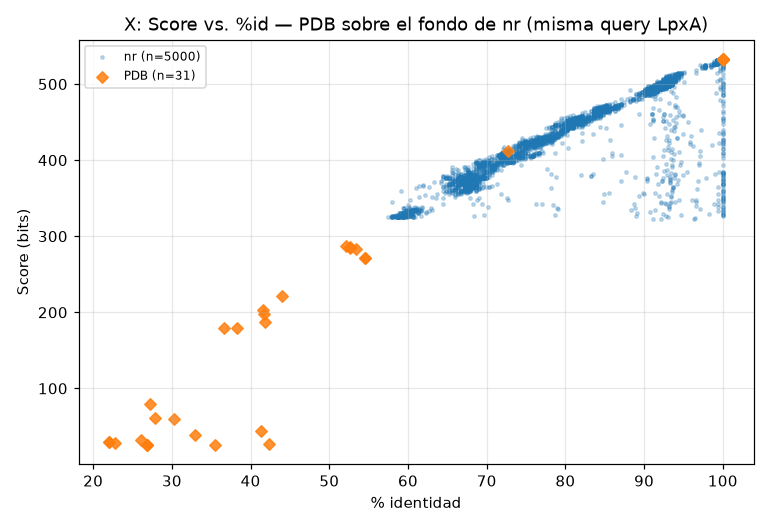

# Desafío X — BLASTp contra PDB

En este desafío comparé la búsqueda contra PDB para la misma secuencia del desafío IX (RID CXKZKTY6014) con la búsqueda contra nr. El archivo de entrada original es `CXKZKTY6014-Alignment desafio X.txt`; la tabla tabular está en `resultados/blast_x.tsv` y su copia cruda, en `resultados/blast_x.tabular_raw.txt`. La búsqueda contra PDB devolvió 31 hits, frente a los 5000 de nr guardados en `resultados/blast_ix.tsv`.

En PDB, los E-values van de 0.0 a 92: 18 hits tienen E-value ≤ 1e-10 y 8 tienen E-value > 1. La identidad va de 22% a 100%, el score de 26 a 533 y la cobertura del query de 10% a 100%. La entrada `1LXA` corresponde a LpxA de *E. coli* K-12 (`lpxA`, EC 2.3.1.129); `8E62` corresponde a la N-acetiltransferasa Pcryo_0615 de *Psychrobacter cryohalolentis*, de otra vía metabólica pero con un plegamiento relacionado.

## ¿Se obtienen los mismos resultados?

La identificación principal coincide: los primeros hits de PDB incluyen estructuras de LpxA con 100% de identidad, cobertura completa, score 533 y E-value 0.0 (`1LXA_A`, `2JF2_A`, `7OKC_A` y `6P9P_A`). Sin embargo, las dos tablas no son equivalentes. PDB contiene proteínas con estructura resuelta, mientras que nr incluye una colección mucho más amplia de secuencias. Por eso, en PDB hay menos hits y menor diversidad de organismos. Además, varios E-values iguales a 0.0 no permiten ordenar los hits más parecidos entre sí usando solo ese valor.

## Tipos de hits recuperados

1. **Estructuras de LpxA:** `1LXA_A`, `2JF2_A`, `7OKC_A` y `6P9P_A` tienen 100% de identidad y cobertura completa.
2. **Proteínas con función similar en otras especies:** `6OSS_A` tiene 72,7% de identidad. También aparece un grupo con aproximadamente 41–54% de identidad, incluidos `4EQY_A`, `4E6U_A`, `5JXX_A`, `5DEM_A` y `1J2Z_A`; sus E-values son ≤ 1e-55 y la cobertura es casi completa.
3. **Homólogos más distantes:** `8E62_A` tiene 27,3% de identidad y E-value 2,7e-17 en un alineamiento de 220 aminoácidos. Está anotada como una N-acetiltransferasa de otra vía. También aparecen `2IU8_A` y `4E75_A`, con E-values cercanos a 1e-9 y 1e-10. En estos casos, el parecido de secuencia es más difícil de interpretar por sí solo; la relación de plegamiento aporta contexto.
4. **Alineamientos débiles o parciales:** ocho hits tienen E-value > 1, hasta 92, y coberturas de entre 10% y 70%. Entre los ejemplos están `1B7K_A`, `6NPJ_B`, `2Z4H_A` y algunas proteínas ribosomales alineadas en 41 aminoácidos. Estos resultados no son evidencia suficiente de homología con LpxA.

## ¿Cuándo sirve cada base?

La coincidencia con `1LXA_A` permite relacionar la secuencia con una estructura conocida de LpxA. Otros hits cercanos podrían servir para buscar moldes de modelado, pero antes habría que revisar su cobertura y calidad como moldes. Los hits más distantes pueden sugerir una relación de plegamiento, aunque esa interpretación requiere evidencia estructural adicional.

En cambio, esta búsqueda de PDB no sirve para estimar la diversidad de LpxA en los organismos ni para encontrar el homólogo más cercano disponible por secuencia: su contenido depende de qué proteínas tienen estructura resuelta. Para este trabajo, nr aporta una lista más amplia de secuencias y PDB permite relacionar los resultados con estructuras disponibles.
